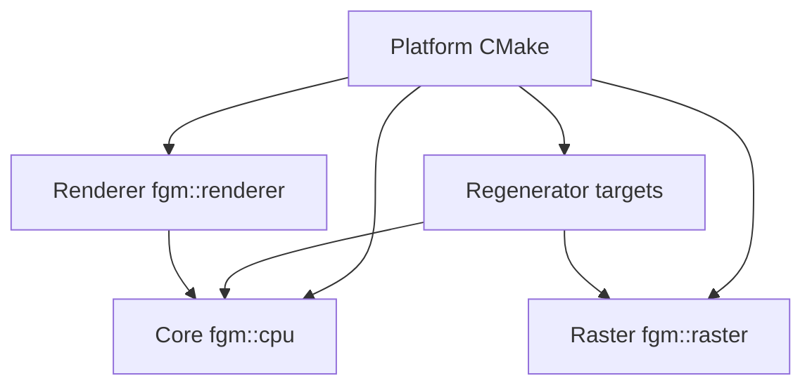

# Локальная Platform

## Сборка и проверка

Нужны CMake ≥3.24, C++20 compiler, Python 3 и Node.js 24. Одна установка npm обслуживает Platform и Renderer; отдельный Renderer lock удалён с сохранением versions/resolved/integrity всех зависимостей.

```sh
npm ci --ignore-scripts --no-audit --no-fund
npm run test:node --workspace renderer
cmake -S . -B build/native -DCMAKE_BUILD_TYPE=Release -DBUILD_TESTING=ON
cmake --build build/native --config Release --parallel 2
node scripts/check-ctest.mjs build/native --suite platform --config Release
ctest --test-dir build/native -C Release --output-on-failure --verbose --no-tests=error
```

Одна процедура собирает Core, Raster, все native Regenerator CLI и scene/camera Renderer. Внешний JSON dependency закреплён версией/хешем; CMake также поддерживает установленный `nlohmann_json` 3.12.0. Внутренние FGM-репозитории из сети не загружаются. `BUILD_TESTING=OFF` выключает регистрацию тестов без отключения библиотек/CLI; `FGMC_BUILD_TESTS`, `FGMR_BUILD_TESTS` и `FGMV_BUILD_TESTS` управляют внутренними suites. Standalone модули используют соседние локальные targets.

30 обязательных root CTests: три Core, 18 Regenerator R12/R01–R07/RV01, четыре native Studio JS contracts, два Raster RVI/C05 oracle, две камеры Renderer и один scene oracle. Отдельный Core public API consumer имеет suite 1/1. Inventory отвергает пропущенный тест, пустую команду, duplicate, disabled/skip/WILL_FAIL; `ctest --no-tests=error` обязателен. Камеры исполняют прежние математические тесты и JS assertions на CMake-built binaries, включая Windows без отдельного g++.

Scene oracle независимо сравнивает все 16384 поля synthetic sphere с аналитической формулой, требует заполненные и пустые точки, побайтово повторяемый результат и отказ на неверном пакете. Это ограниченный corpus, а не универсальное доказательство всех FGM.

`FGMV_BUILD_GPU_DEMO=ON` включает прежний `fgm_boot` с явным `WGPU_ROOT` (wgpu-native v29.0.1.1). По умолчанию SDK не требуется для CPU scene/camera. GPU и Emscripten ветви сохранены для отдельной проверки S06B; успешный CPU CTest не доказывает GPU/browser parity.

## Владельцы и направления



`fgm::cpu` — единственный production FGM evaluator. `fgm::raster` — одна CPU RVI реализация, используемая R07 и собственными RVI/C05 tests. Код, tests, fixture и основные test/mutation scripts принадлежат `raster/`; математических копий в Renderer нет. Namespace `rvi` и математическая семантика сохранены. `fgm::renderer` — alias существующего `boot_scene`, объединяющего прежние scene и camera исходники, без новой математической реализации. Regenerator и Renderer не зависят друг от друга.

`regenerator/src/projection.*` сохраняет integer R05 tile/LOFT/sprite mathematics. RVI continuous rays и integer source projection имеют разные контракты. Аналитическая occupancy RVI служит независимым C05 oracle. Значение `coreRevision=ba91a5e...` в прежнем протоколе обозначает сохранённую семантику, не network dependency и не текущий Platform HEAD.

## Текущая защита и WASM/browser

`check-platform.mjs` развивается тем же файлом в policy/3: scope S06A→S06B, fixed reviewed verifier bytes и явные Requirement transforms. Четыре нормативных текста адаптированы к новой авторской стратегии: FGMP-PROJECT-000, FGMP-BUILD-001, FGMP-RENDERER-001, FGMV-PUB-003. ID/lifecycle не продвигаются. Новый FGMP-WASM-001 имеет false/false/false. Исторические архивы/replay и наличие старых source commits не являются текущим CI gate; временные baseline rules удаляются на S08 после функциональной замены.

Существующие root native Ubuntu/Windows и RepoGuard сохранены. Один дополнительный Ubuntu job в том же native workflow заменяет старые Regenerator/Renderer verification workflows: обе WASM-библиотеки, native GPU frame, Worker parity, реальный Chromium/depth/holes/4K/cancel/negative, RV01, package validators и RVI source mutations. Он проверяет сборку при заблокированных Git URL трёх старых repos. Browser network guard разрешает только локальные синтетические запросы; собственный отрицательный тест доказывает блокировку реальных Chromium запросов к старым repos.

Четыре aliases, десять дополнительных старых verified_by и временный Node invocation удалены; Raster и общий language suite вызываются напрямую. Старые workflow удаляются после подтверждения root replacement CI. Единственный оставшийся nested Pages workflow dormant до S07.

После установки Emscripten 4.0.21 и root npm workspace:

```sh
emcmake cmake -S . -B build/wasm -DCMAKE_BUILD_TYPE=Release -DBUILD_TESTING=OFF
cmake --build build/wasm --parallel 2
npm run build --workspace renderer
node renderer/scripts/build-studio-s2a.mjs build/wasm
```

CMake записывает Platform revision/TREE в `build/wasm/platform-build.json`; producer сверяет их с чистым текущим checkout и отбирает девять фиксированных активов. `engine-lock.json` задаёт только действующий protocol/whole-build/core semantic contract, не источник Git. Манифест пакета хранит один Platform revision/TREE и hashes. `core` — инертный идентификатор математической семантики из runtime, не network pin. Чужая ревизия/TREE, dirty tracked source, empty/неверный WASM или небезопасный output path отвергаются.

Обычный review artifact этой CI предназначен для проверки текущего пакета, не для архивирования старой истории. Пакет ещё не публикуется: единый Pages/release/rollback, live smoke и визуальная авторская приёмка — S07. Private Stage A, browser R07 fit и универсальное доказательство всех моделей FGM не заявляются.

## Финальная цель

На S08 нужны FUNCTIONAL_PASS, INDEPENDENCE_PASS, REQUIREMENTS_PASS, SIMPLIFICATION_PASS: автономный рабочий продукт при недоступности старых трёх repos, актуальные требования и незавершённый roadmap, отсутствие лишних зависимостей/дубликатов/миграционной инфраструктуры. Полные Git/Issues/PR/CI архивы не требуются. Migration manifests/checkers/policies и старые текущие ссылки выводятся после предметной замены; необходимые tests/fixtures и лицензии остаются. Удаление старых repos — только отдельная финальная авторская операция.
