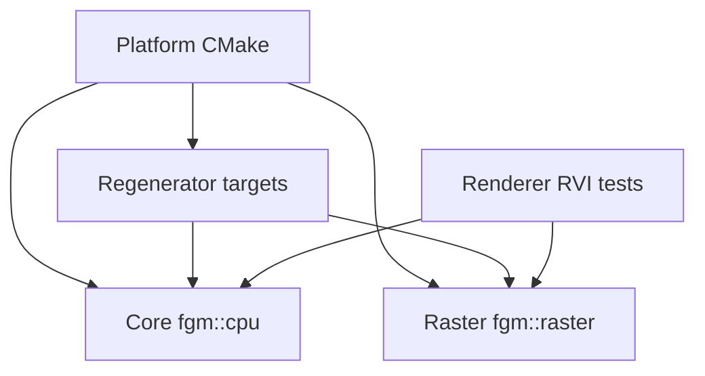

# Локальная native Platform

## Сборка и проверка

Нужны CMake ≥3.24, C++20 compiler, Python 3 и Node.js 24.

```sh
cmake -S . -B build/native -DCMAKE_BUILD_TYPE=Release -DBUILD_TESTING=ON
cmake --build build/native --config Release --parallel 2
node scripts/check-ctest.mjs build/native --suite platform --config Release
ctest --test-dir build/native -C Release --output-on-failure --verbose --no-tests=error
```

Одна процедура собирает Core, Raster и все native Regenerator CLI. Внешний JSON dependency закреплён версией/хешем; CMake также поддерживает установленный `nlohmann_json` 3.12.0. Внутренние FGM-репозитории из сети не загружаются. `BUILD_TESTING=OFF` выключает регистрацию тестов без отключения библиотек/CLI; `FGMC_BUILD_TESTS` и `FGMR_BUILD_TESTS` управляют внутренними suites независимо. Standalone entry points модулей используют соседние локальные targets, а не старые Git repos.

27 обязательных root CTests: три Core, 18 прежних Regenerator R12/R01–R07/RV01, четыре native Studio JS contracts и два существующих Renderer RVI/C05 oracle. Отдельный Core public API consumer имеет свою точную suite 1/1. Проверяющий inventory отвергает пропущенный тест, пустую команду, duplicate, disabled/skip/WILL_FAIL; `ctest --no-tests=error` обязателен.

## Владельцы и направления



`fgm::cpu` — единственный FGM evaluator. `fgm::raster` заменяет прежний `fgmr-v02`: это те же байты CPU analytic renderer `rvi-v02`, а не новая реализация. Два реальных потребителя — R07 panel fit и Renderer RVI/C05 oracle. Namespace `rvi` и математическая семантика сохранены. GPU и Regenerator CLI не являются зависимостями Raster. Regenerator и Renderer не зависят друг от друга.

`regenerator/src/projection.*` остаётся владельцем integer R05 tile/LOFT/sprite mathematics. RVI continuous rays и integer source projection имеют разные контракты и единицы. Их механическое объединение изменило бы семантику. Аналитическая occupancy в RVI служит независимым oracle C05, а не альтернативным production FGM interpreter.

Значение `coreRevision=ba91a5e...` в прежнем native протоколе обозначает сохранённую семантическую реализацию. Оно не запускает Git fetch и не выдаётся за текущий Platform HEAD. Policy подтверждает неизменность исходников evaluator, Regenerator алгоритмов и Python orchestration относительно принятого baseline.

## Текущая защита

`scripts/check-platform.mjs` — единственная current Platform policy, версия `fgm-platform-policy/1`, область `S04-to-S05-native-core-raster-regenerator`. Она проверяет exact baseline/history trees, разрешённые изменения путей/связей, единственное происхождение перенесённого RVI, сохранение 78 существовавших normative/ID/lifecycle/constraints и 79 canonical Requirements. Critical CMake/CI/verifier bytes имеют фиксированные mode/blob/SHA-256. Ожидания не читаются из migration manifest. Сам checker и новые constants требуют независимого аудита exact HEAD; самоподписывающаяся защита не заявляется.

Две обычные root CI-проверки на каждой ОС: native предметные tests и current policy mutations. Отдельный RepoGuard job проверяет J1/J2/J3, bootstrap и реальные positive/orphan/missing-verifier/missing-target transitions. Существующие S02/S03/S04 checker-файлы не вызываются на текущем HEAD.

Baseline-specific allowlists/фиксированная карта текущего перехода — временная часть policy. Owner: S05 / Issue #8. На S06 политика развивается одной версией, не импортируя каскад старых checker. На S08 / Issue #14 временные правила должны быть заменены устойчивыми current invariants, а одноразовые manifests/checkers выведены из активного дерева после архивной проверки. RepoGuard, предметные negative tests и строгий CTest остаются.

## Исторические доказательства

Исторические accepted snapshots доступны по immutable Git objects:

| Этап | HEAD | TREE |
| --- | --- | --- |
| S02 | `faff85c3683a7dd87026796bf33ad11ac6d22b33` | `de224a85b0957ca1de1e26d593a3c1ee099f85e2` |
| S03 | `4c46d0f3aa2176a8d63448c01df55614ce169956` | `e0f16e7dcbbb66f713f9e3a529291e2e632f78bb` |
| S04 | `5f5971eae131b2b5c79992203d2f27281d217a75` | `0410d0f6dd49247c53ee0f43a0426f8d82539543` |

[S04 postmerge receipt](https://github.com/netkeep80/fgm-platform/issues/7#issuecomment-6974835910) содержит независимый аудит, приёмку, пять свежих Ubuntu/Windows CI jobs и проверку merge. Сохранность исторического oracle проверяется на старом checkout, а не по новому manifest.

On-demand replay предусмотрен через `workflow_dispatch` в `source-snapshots.yml`: checkout **точного S04 HEAD**, исходные S02/S03/S04 suites, старые verifiers/manifests и закреплённый compiler для typed mutations. Этот job не входит в ordinary PR CI. Пока candidate workflow не смержен в default branch, его dispatch ещё недоступен; локальное frozen-replay и исходные immutable primary CI receipts служат проверяемым доказательством перед аудитом замены.

Локальное воспроизведение (нужны Node/yaml dependencies из исходного package-lock):

```sh
git worktree add --detach ../fgm-proof 5f5971eae131b2b5c79992203d2f27281d217a75
cd ../fgm-proof
npm ci --ignore-scripts --no-audit --no-fund
python -m unittest discover -s tests -p test_source_snapshots.py -v
node --test tests/requirements-migration.test.mjs tests/core-integration.test.mjs tests/ctest-gate.test.mjs
node scripts/check-requirements-migration.mjs 4c46d0f3aa2176a8d63448c01df55614ce169956
node scripts/check-core-integration.mjs 5f5971eae131b2b5c79992203d2f27281d217a75
```

## Границы и оставшееся упрощение

В этом native срезе не заявляются выполнение WASM/Chromium suites, browser R07 fit, private Stage A или Studio release. Их исходники/fixtures и прежний nested workflow сохранены до замены на S06/S07. Пять dormant nested workflow, дубликаты language checks и документации классифицируются по Issue #33; их наличие не означает запуск в root CI. Физический retirement migration-support и внешняя архивная проверка относятся к S08. Итоговые `MIGRATION_PASS` и `SIMPLIFICATION_PASS` принимаются раздельно.

Разработка и тесты используют только public synthetic fixtures. Приватные UFO assets, производные модели и пути не публикуются.
