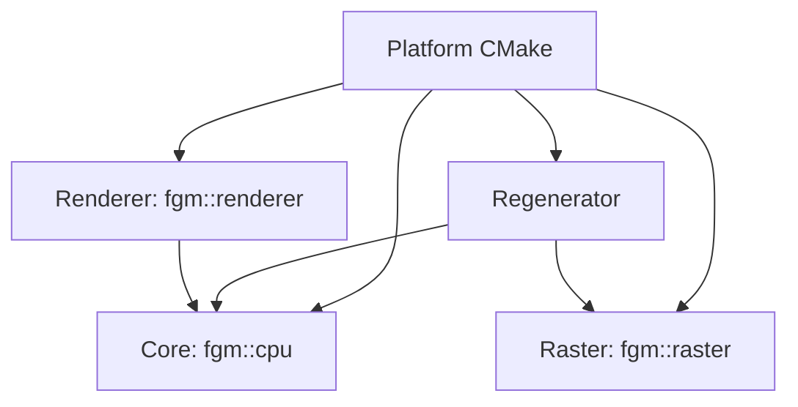

# Разработка FGM Platform

## Одна сборка

Команды и зависимости native-сборки приведены в [README](../README.md). CMake ≥3.24 и C++20 собирают локальные Core/Raster/Regenerator/Renderer. Python 3 обслуживает парсеры и оркестрацию, Node.js 24 — контракты и браузерные проверки. Один root npm workspace и lockfile обслуживают Renderer. Внешний `nlohmann_json` 3.12.0 закреплён SHA-256; установленный пакет той же версии также поддерживается.

`BUILD_TESTING=OFF` отключает регистрацию тестов, сохраняя библиотеки и CLI. `FGMC_BUILD_TESTS`, `FGMR_BUILD_TESTS`, `FGMV_BUILD_TESTS` управляют внутренними suites. `FGMV_BUILD_GPU_DEMO=ON` с `WGPU_ROOT` включает native WebGPU demo; CPU scene/camera не требуют GPU SDK.



`fgm::cpu` — единственный production evaluator. `fgm::raster` — одна CPU RVI реализация для R07 и независимых oracle tests. Regenerator и Renderer не зависят друг от друга. Integer R05-проекция источников и непрерывные лучи RVI имеют разные математические контракты. Поле `coreRevision` в прежнем runtime protocol — идентификатор математической семантики, а не сетевой источник или текущий Platform HEAD.

## Предметные проверки

Один `.github/workflows/platform.yml` исполняет четыре verification jobs: RepoGuard, Native Ubuntu, Native Windows и WASM/WebGPU/Chromium Ubuntu. До RepoGuard выполняются общий language suite, YAML/permissions/workflow negatives и реальные синтетические BASE/HEAD transitions. Проверка обязательных команд CI отвергает выключенные tests, успешный echo вместо проверки, path filters для main push и публикацию из PR.

Native inventory содержит 30 тестов: Core/C05/consumer, R01–R07/R12/RV01, Studio, Raster RVI и Renderer scene/camera. Состав, непустые команды и отсутствие disabled/skip/WILL_FAIL проверяются отдельно от CTest. C05 сопоставляет поля, material/contributor, повторы и порядок запросов. Scene oracle проверяет 16384 аналитические выборки. Это конкретные корпуса, не универсальное доказательство всех моделей.

WASM job собирает оба движка из того же checkout, выполняет Native/Node Worker/Chromium protocol/cell/catalog/whole parity, native/GPU frame parity, depth/occlusion/holes, ограниченный 4K readback, cancellation/epoch и source mutations. Он блокирует Git-доступ к прежним FGM репозиториям до сборки; браузерный network guard допускает только проверенные синтетические ресурсы. Доступность прежних репозиториев не нужна для работы Platform.

## WASM и браузер

После установки Emscripten 4.0.21, Node.js 24 и root npm workspace:

```sh
emcmake cmake -S . -B build/wasm -DCMAKE_BUILD_TYPE=Release -DBUILD_TESTING=OFF
cmake --build build/wasm --parallel 2
npm run build --workspace renderer
node renderer/scripts/build-studio-s2a.mjs build/wasm
```

CMake записывает source SHA/TREE в `build/wasm/platform-build.json`. Producer независимо сверяет их с чистым checkout, engine contract и девятью разрешёнными активами. Dirty source, чужие SHA/TREE, пустой/неверный WASM и небезопасные output paths отвергаются. Review-сайт и production используют один validator и один producer.

## Автоматическая публикация

Каждый принятый merge в main, включая README/docs/requirements/CI-only, запускает тот же workflow без path filters. После четырёх verification jobs publisher принимает их неизменяемый CI artifact: repository/run/attempt/workflow/source SHA/TREE, provider digest, allowlist и полный hash index. Повторной сборки перед публикацией нет.

Единственный privileged main job повторно проверяет актуальность main, развёртывает Pages, сверяет публичные HTTP hashes/версию/SHA/TREE и выполняет настоящий WASM/Chromium smoke. Затем ZIP и Sigstore bundle сохраняются как продуктовый Release. PR jobs не получают publishing permissions. При ошибке после deploy код сохраняет исходный отказ и восстанавливает ранее аутентифицированный пакет, если он есть. Операционные drills не являются отдельным ручным шагом обычного main merge.

[Инструкция пакета и подписанного recovery](../renderer/docs/studio-pages.md). Source logs и признаки MERGED/PUBLISHED/ACCEPTED фиксируются отдельно в [Issue #1](https://github.com/netkeep80/fgm-platform/issues/1). Код verifiers, workflow и Requirements проверяются независимым exact-HEAD review; локальные тесты не самоподписывают проверяющий код.

## Дальнейшая работа

[Самостоятельный текущий roadmap](https://github.com/netkeep80/fgm-platform/issues/15) описывает ещё не реализованные Core safety/conformance, cache/incremental regeneration, интерактивный R07, материалы/LOD, анимацию, профили и расширение платформ. Private [Stage A](https://github.com/netkeep80/fgm-platform/issues/11), [Stage B](https://github.com/netkeep80/fgm-platform/issues/12) и [игровая интеграция](https://github.com/netkeep80/fgm-platform/issues/13) сохраняют собственные scope/acceptance. Оригинальные игровые байты не публикуются. Все лицензии и предметные fixtures сохранены.
