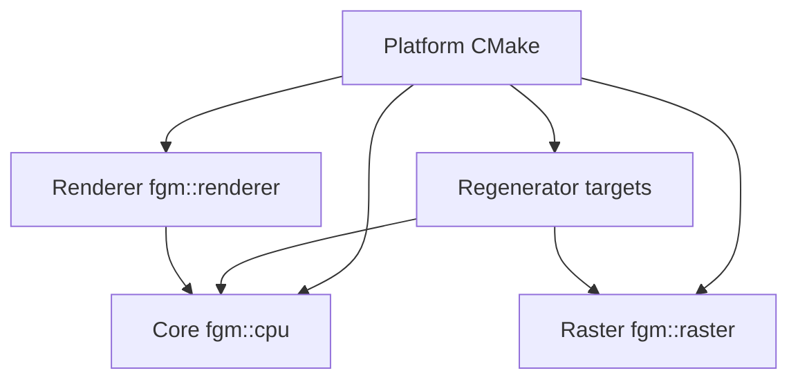

# Локальная Platform

## Сборка и проверка

Нужны CMake ≥3.24, C++20 compiler, Python 3 и Node.js 24. Одна установка npm обслуживает Platform и Renderer; отдельный Renderer lock удалён с сохранением versions/resolved/integrity всех зависимостей.

```sh
npm ci --ignore-scripts --no-audit --no-fund
npm run test:node --workspace renderer
cmake -S . -B build/native -DCMAKE_BUILD_TYPE=Release -DBUILD_TESTING=ON
cmake --build build/native --config Release --parallel 2
node scripts/check-ctest.mjs build/native --suite platform --config Release
ctest --test-dir build/native -C Release --output-on-failure --verbose --no-tests=error
```

Одна процедура собирает Core, Raster, все native Regenerator CLI и scene/camera Renderer. Внешний JSON dependency закреплён версией/хешем; CMake также поддерживает установленный `nlohmann_json` 3.12.0. Внутренние FGM-репозитории из сети не загружаются. `BUILD_TESTING=OFF` выключает регистрацию тестов без отключения библиотек/CLI; `FGMC_BUILD_TESTS`, `FGMR_BUILD_TESTS` и `FGMV_BUILD_TESTS` управляют внутренними suites. Standalone модули используют соседние локальные targets.

30 обязательных root CTests: три Core, 18 Regenerator R12/R01–R07/RV01, четыре native Studio JS contracts, два Raster RVI/C05 oracle, две камеры Renderer и один scene oracle. Отдельный Core public API consumer имеет suite 1/1. Inventory отвергает пропущенный тест, пустую команду, duplicate, disabled/skip/WILL_FAIL; `ctest --no-tests=error` обязателен. Камеры исполняют прежние математические тесты и JS assertions на CMake-built binaries, включая Windows без отдельного g++.

Scene oracle независимо сравнивает все 16384 поля synthetic sphere с аналитической формулой, требует заполненные и пустые точки, побайтово повторяемый результат и отказ на неверном пакете. Это ограниченный corpus, а не универсальное доказательство всех FGM.

`FGMV_BUILD_GPU_DEMO=ON` включает прежний `fgm_boot` с явным `WGPU_ROOT` (wgpu-native v29.0.1.1). По умолчанию SDK не требуется для CPU scene/camera. GPU и Emscripten ветви сохранены для отдельной проверки S06B; успешный CPU CTest не доказывает GPU/browser parity.

## Владельцы и направления



`fgm::cpu` — единственный production FGM evaluator. `fgm::raster` — одна CPU RVI реализация, используемая R07 и собственными RVI/C05 tests. Код, tests, fixture и основные test/mutation scripts принадлежат `raster/`; математических копий в Renderer нет. Namespace `rvi` и математическая семантика сохранены. `fgm::renderer` — alias существующего `boot_scene`, объединяющего прежние scene и camera исходники, без новой математической реализации. Regenerator и Renderer не зависят друг от друга.

`regenerator/src/projection.*` сохраняет integer R05 tile/LOFT/sprite mathematics. RVI continuous rays и integer source projection имеют разные контракты. Аналитическая occupancy RVI служит независимым C05 oracle. Значение `coreRevision=ba91a5e...` в прежнем протоколе обозначает сохранённую семантику, не network dependency и не текущий Platform HEAD.

## Текущая защита

`scripts/check-platform.mjs` — единственная current policy, `fgm-platform-policy/2`, область `S05-to-S06A-native-renderer-raster-ownership-shared-quality`. Exact baseline, immutable history trees, разрешённые path/verification transforms, сохранение 79 прежних нормативных субъектов и 80 canonical Requirements проверяются независимо от manifest. Critical CMake/CI/verifier bytes имеют фиксированные mode/blob/SHA-256. Сам checker и constants требуют независимого аудита exact HEAD; самоподписывающаяся защита не заявляется.

Один общий `scripts/check-document-language.mjs` и suite из пяти тестов заменяют три идентичные копии. Три DOC requirement ID сохраняют свою нормативную область и ссылаются на общий verifier. Проверка выполняется перед RepoGuard. Core Node запускает 59 уникальных domain tests; Renderer TS/Node — 11 trust/lifecycle/Studio tests. Дублирующиеся language tests не выдаются за дополнительные предметные проверки.

Две root CI-проверки на каждой ОС: native/Node и current policy mutations. Отдельный RepoGuard job проверяет J1/J2/J3, bootstrap и реальные typed negatives. Две заменённые nested guard workflow Core/Regenerator удалены; все их уникальные проверки выполняются корневыми jobs. Старые источники и точные workflow blobs сохранены в принятом S05 HEAD.

Baseline-specific правила policy временные: owner S06 / Issue #9; S08 / Issue #14 заменяет их устойчивыми current invariants после архивной проверки. Нового stage-checker/manifest и ежедневного каскада нет. Предметные negatives, RepoGuard и строгий CTest сохраняются.

## Исторические доказательства

| Этап | HEAD | TREE |
| --- | --- | --- |
| S02 | `faff85c3683a7dd87026796bf33ad11ac6d22b33` | `de224a85b0957ca1de1e26d593a3c1ee099f85e2` |
| S03 | `4c46d0f3aa2176a8d63448c01df55614ce169956` | `e0f16e7dcbbb66f713f9e3a529291e2e632f78bb` |
| S04 | `5f5971eae131b2b5c79992203d2f27281d217a75` | `0410d0f6dd49247c53ee0f43a0426f8d82539543` |
| S05 | `0ed4c333cfed939b13180029871043900b372520` | `6abd50abcc801f44ead655cdf60a1f96edcad193` |

[Новый S04 frozen replay](https://github.com/netkeep80/fgm-platform/issues/8#issuecomment-6979806869) подтвердил S02/S03/S04 integrity и typed negatives на Ubuntu/Windows. [S05 принятие и postmerge](https://github.com/netkeep80/fgm-platform/issues/8#issuecomment-6978339609) сохраняет первичные native/policy CI. Через `workflow_dispatch` в `source-snapshots.yml` отдельно воспроизводятся frozen S04 и S05 policies/tests; ordinary PR не исполняет этот исторический каскад.

```sh
git worktree add --detach ../fgm-proof 0ed4c333cfed939b13180029871043900b372520
cd ../fgm-proof
npm ci --ignore-scripts --no-audit --no-fund
node --test tests/platform-policy.test.mjs tests/ctest-gate.test.mjs
node scripts/check-platform.mjs 0ed4c333cfed939b13180029871043900b372520
```

## Оставшиеся gates

S06A — native Renderer/ownership/shared quality. S06B обязан выполнить реальные GPU/WASM/Chromium worker/depth/occlusion/holes suites на локальных исходниках и заменить две оставшиеся verification workflow. S07 заменяет отдельный legacy Pages pipeline после release hashes/rollback и визуальной авторской приёмки. Три dormant nested workflow пока сохраняют неперенесённое покрытие; их наличие не означает запуск в Platform CI.

Физический retirement исторических manifests/checkers и внешняя архивная проверка — S08. Итоговые `MIGRATION_PASS` и `SIMPLIFICATION_PASS` принимаются раздельно. Private Stage A, browser R07 fit и обновление production Studio здесь не заявляются. Используются только public synthetic fixtures; приватные UFO assets, производные модели и пути не публикуются.

## Временная совместимость execution-связей

RepoGuard v6.0.1 проверяет ограничения из AUTHORITY/BASE/HEAD и требует наличия старого verifier в HEAD. Поэтому этот переход сохраняет четыре минимальных alias: три `*/tests/document-language.test.mjs` импортируют одну общую suite, `renderer/scripts/test-v02.mjs` запускает Raster oracle. Их точное содержимое закреплено policy; прежние `verified_by` связи сохранены дополнительно к новым, а constraints уже указывают на новые пути. Это не отдельные реализации или обход J3. Language aliases исполняются в одном Node процессе с общим import cache: пять тестов выполняются один раз. Raster CTest проходит через старый alias к новой единственной реализации.

Owner — S06/#9. Условие удаления на S06B: принятый BASE содержит новые execution paths; убрать четыре alias, дополнительные прежние verification связи и временный режим Node одновременно, сохранив прямые suites и RepoGuard J3. Исторический immutable S05 verifier не изменён. Срез не объявляет эти временные entrypoints окончательной архитектурой.
